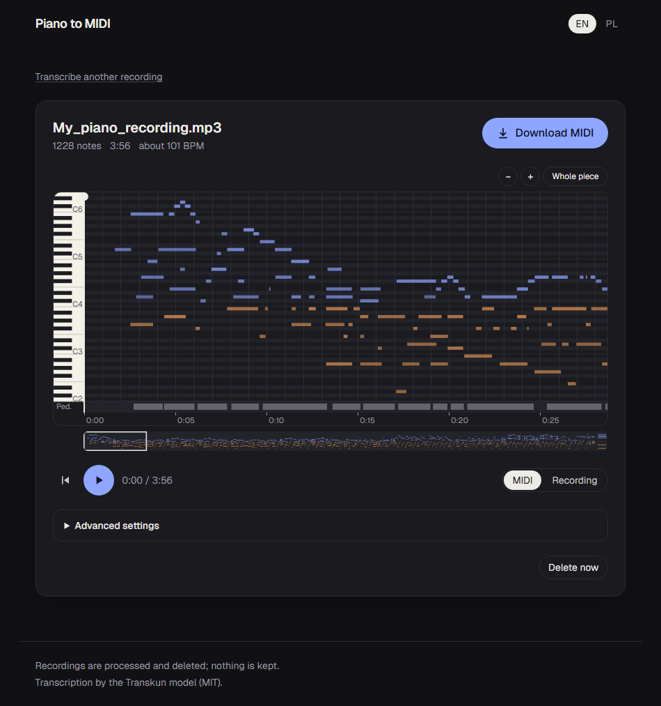

# Piano to MIDI

Turns a piano recording into a MIDI file with notes, dynamics and pedal, ready to edit in a DAW. Transcription runs the [Transkun](https://github.com/Yujia-Yan/Transkun) model on the CPU; sensitivity, quantisation and hand split are applied afterwards, without running the model again.



```bash
cd backend && uv sync && uv run uvicorn pianotomidi.main:app --port 8100
```

```bash
cd frontend && pnpm install && pnpm dev
```

MIT License.
